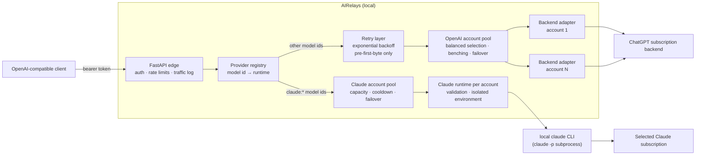
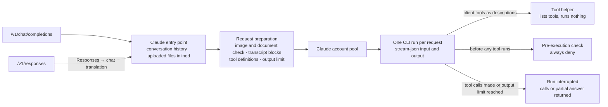
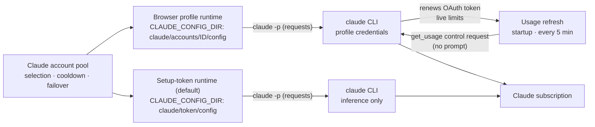
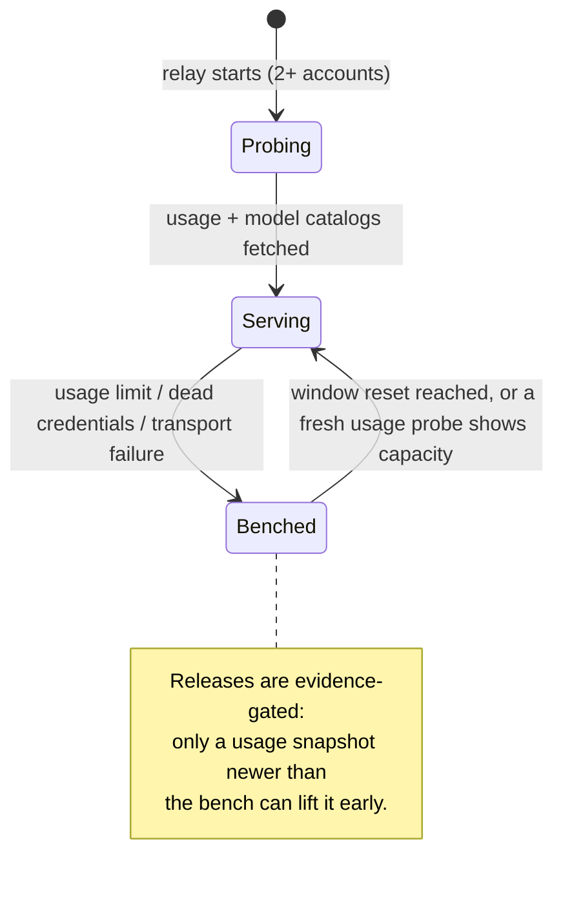

# Architecture

## Overview

AIRelays is an OpenAI-shaped edge over provider-specific local runtimes.

- The default runtime uses the ChatGPT Codex subscription backend and
  balances requests across every enrolled OpenAI account with capacity.
- The Claude account pool selects an AIRelays-owned CLI profile for each
  local `claude -p` subprocess. Claude Code owns authentication and token
  refresh; the personal Claude Code sign-in is never used.

## Request Flow

1. FastAPI receives an OpenAI-shaped request.
2. Middleware enforces relay auth and local abuse controls.
3. AIRelays resolves the request model id to a provider runtime.
   OpenAI model admission uses the account-scoped upstream catalog; catalog
   requests follow the installed Codex version in automatic mode. Claude
   refreshes the installed CLI's initialization catalog on demand and
   registers its aliases and concrete model ids before resolving requests.
   Catalogs use a bounded cache, with an explicit refresh path shared by
   the API and desktop Models page. Discovery does not submit inference
   prompts.
4. Images and documents are checked the same way for both runtimes before any upstream call. The OpenAI runtime uses the shared request/response transforms plus the OpenAI backend adapter. Claude requests from every route go through one entry point: `/v1/responses` bodies are translated to the chat shape and back, conversation history is attached, uploaded files are inlined, and the Claude runtime turns the conversation into the single message one CLI run receives (see [Claude Request Path](#claude-request-path)).
5. On the OpenAI runtime, the account pool picks the account: conversation affinity first, then — among accounts with capacity that serve the requested model — the one with the most remaining quota in its longest usage window (`balance = "balanced"`, the default), strict rotation (`"round_robin"`), or the first such account (`"ordered"`). Which usage windows an account reports is plan-dependent, so the pool ranks windows by duration and balances on the longest (weekly) budget — the scarce one — while short-window exhaustion is handled by benching and failover. Accounts already benched (a usage probe or an earlier request showed their window is spent) are skipped outright, so requests route straight to accounts with capacity. Account-scoped failures (usage limits, in-stream failure events, dead credentials, transport errors) bench the account until it recovers and fail over to the next one — only before any content byte reaches the client; on streams, events that precede content are buffered so this guarantee holds.
6. If every account fails, the retry layer waits an exponential backoff (`retry_attempts`, default 3 retries at 5s/20s/60s) and re-runs the whole pool pass — again only while no response byte has reached the client. Quota errors whose reset lies beyond the backoff budget return immediately.
7. The selected runtime returns streamed or aggregated output in the matching OpenAI-shaped envelope; failures return OpenAI-shaped error JSON with the upstream's own reason, and failures after streaming started surface in-band.
8. AIRelays logs the request, runtime selection, account selection, retries, and result.

Claude selection uses available account slots, fresh weekly usage, and known
model-specific limits. Without fresh usage, eligible accounts rotate. A CLI
authentication, quota, or transient failure puts the account into cooldown;
the pool can try another eligible account before any response bytes are sent.
Each Claude request is one fresh CLI run; conversation history, when a
client uses `conversation`, is kept by AIRelays and sent with each turn, so
there is no account affinity across turns.

## Claude Request Path

Each Claude request is one CLI run that receives the whole conversation as a
single user message, with images and documents in place, so a turn is one
model call. Built-in CLI tools are off; the client's function tools reach the
CLI only as descriptions served by a helper that executes nothing, every call
is denied before execution, and the run stops as soon as Claude has made its
calls. The CLI's own report of available tools is checked on every request.
See [Tool calls on Claude models](api.md#tool-calls-on-claude-models) and
[Capabilities](capabilities.md).

`airelay.claude_auth` owns enrollment metadata under
`data_dir/claude/accounts/<id>/account.json`. Each adjacent `config/` directory
is owned by Claude Code and stays at a stable path because macOS credentials
are scoped to it. The optional setup token (`data_dir/claude-token`) is the
inference-only account `default`, run from its own relay-owned
`data_dir/claude/token/config`. The ambient Claude Code sign-in, an inherited
`CLAUDE_CONFIG_DIR`, and `CLAUDE_CODE_OAUTH_TOKEN` are not accounts.
`airelay.claude_accounts` owns selection and failover; `ClaudeCliRuntime` owns
per-profile execution, model discovery, and usage backoff.

Usage readings come from the profile's own CLI through the Claude Code SDK
`get_usage` control request, at startup and every five minutes; AIRelays never
reads Claude credentials. Claude Code renews the profile's token while
answering, which keeps idle profiles signed in. A reading without live data
keeps the last good one, marked stale, and failures back off up to 60 minutes,
persisted across restarts. Every Claude Code process gets an explicit
environment, its profile's `CLAUDE_CONFIG_DIR`, and a relay-owned working
directory, and is ended gracefully (stdin closed or SIGTERM before SIGKILL).
See [the profile decision](adr/0006-isolated-claude-subscription-accounts.md)
and [relay-owned accounts](adr/0007-relay-owned-claude-accounts.md).

The personal Claude Code sign-in (`~/.claude`) is not part of this picture:
AIRelays never reads it, routes through it, or signs it out.

## OpenAI Account Pool Lifecycle

At launch, a multi-account pool probes each account's usage and model
catalog in the background, so accounts already at their limit are benched
and model-aware balancing works from the first request.

The public OpenAI model catalog is the union across enrolled accounts.
Selection, affinity, and every failover attempt are restricted to the
requested model's supporting subset, never to an unsupported account as a
last resort. Per-account catalogs are also refreshed before routing when
their TTL expires. Catalog failures retain last-known routing membership;
they do not establish support on an unknown account.

## Main Components

### `airelays.config`

- config resolution
- local paths
- relay token state
- provider toggles and runtime guardrails

### `airelays.private_io`

- owner-only directories and atomically replaced owner-only files, the same
  way on every OS (ADR 0008)
- the cross-process lock that serializes OpenAI token refreshes

### `airelays.security`

- relay bearer auth
- per-IP limits
- temporary bad-token blocks

### `airelays.auth`

- AIRelays-owned OpenAI subscription auth
- browser and device login
- token refresh

### `airelays.accounts`

- multi-account discovery and storage slots
- balanced account selection (capacity-aware default; round-robin and ordered opt-ins)
- usage-limit benching with evidence-gated release
- cached, single-flighted usage probes with a background refresher
- account failover and launch-time capacity/model warm-up

### `airelays.backend`

- OpenAI runtime HTTP calls to the verified ChatGPT backend
- structured errors for upstream HTTP, transport, and in-stream failures

### `airelays.retry`

- automatic retry with exponential backoff for failed OpenAI upstream calls
- runs only while no response byte has reached the client
- skips retries a quota reset horizon proves futile; stops for disconnected clients

### `airelays.providers`

- provider registry
- provider model catalogs
- provider readiness
- Claude runtime

### `airelays.claude_launch`

- one launcher for every `claude` process: resolution, child environment,
  argument limits, and per-OS process flags (no console windows on Windows)

### `airelays.transforms`

- OpenAI runtime request and response translation
- unknown-parameter disclosure and output-token limits for both runtimes

### `airelays.media`

- the image and document check shared by both runtimes (format sniffing,
  size caps)

### `airelays.claude_content`

- chat messages as the single transcript message a Claude CLI run receives,
  with images and documents in place

### `airelays.chat_responses`

- `/v1/responses` on top of the Claude chat path: request translation,
  Responses objects and stream events, and conversation item conversion

### `airelays.conversations`

- conversation history: prepended to each turn and recorded once a turn
  succeeds, for both runtimes

### `airelays.claude_tool_stub` and `airelays.claude_tool_guard`

- the tool helper that describes client tools to the Claude CLI and runs
  nothing, and the pre-execution check that denies every client tool call

### `airelays.store`

- local files
- local conversation state (shared by both runtimes)

### `airelays.traffic`

- redacted JSONL logging
- hourly and size rotation, age/total-size retention, and visible storage errors
- shared policy persistence and process locking in `airelays.log_retention`

The relay owns retention; CLI and tray/API controls use the same saved policy.
See [the retention decision](adr/0005-bounded-traffic-log-retention.md) for
ownership, alternatives, migration, and operating limits.

## State Model

OpenAI runtime:

- supports AIRelays local conversations
- supports local file reuse

Claude runtime:

- supports AIRelays local conversations (history sent with each turn)
- supports local file reuse (files inlined into the request)
- each request is a fresh CLI run with session persistence off

## Intentional Boundaries

- no silent fallback across providers
- no blanket parity claim across providers
- no silent truncation
- no fake token budgets
- no reuse of upstream subscription auth as relay-client auth
